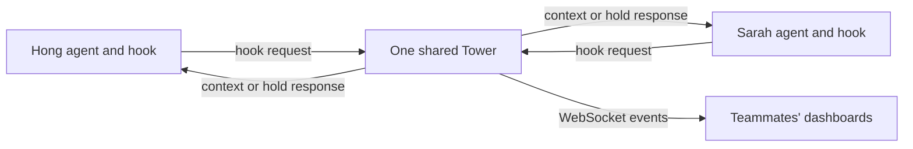

# Tower

We run Tower locally with Node 20+ and pnpm.

We describe shared dashboards, SSH sessions and the proposed remote-client design in [Connecting teammates over Tailscale](#connecting-teammates-over-tailscale).

```sh
pnpm install
pnpm dev
```

We open http://localhost:5173. In another terminal, we play the demo:

```sh
pnpm sim scenarios/demo-full.jsonl
```

We can use `--speed 2`, `--loop`, or `--no-reset`. The simulator retries when the server is unavailable. Each loop resets state unless we pass `--no-reset`.

We run checks and serve the built app with:

```sh
pnpm test
pnpm typecheck
pnpm build
pnpm start
```

The built app is at http://127.0.0.1:4317. We bind the server to `127.0.0.1` only.

We store each run in `.tower/logs/`. Reset starts a new log. We keep server state in memory and do not restore it after a restart. The browser reconnects and receives the current snapshot. We retain the last 50 events in that snapshot and support WebSocket replay with `?since=<seq>` from the current log.

We support real capture and scripted replay. We start in live mode. The simulator resets into scripted mode. In live mode we track claims, predict file overlap, detect collisions and enforce holds. In scripted mode collision and split events come from the scenario. Live negotiation and split acceptance belong to phase 5.

## Real sessions

We prepare a separate demo repo and three worktrees:

```sh
scripts/setup-demo.sh /tmp/tower-demo
TOWER_REPO=/tmp/tower-demo/demo-app pnpm dev
```

We use the exact session commands printed by setup. Each command sets a different `TOWER_PILOT` and puts the local `tower-hook` link on PATH. We review and trust the Codex project and its hooks with `/hooks` before an interactive session. We do not need API keys for Tower.

We scan the tracked files in `TOWER_REPO` on start and reset. We skip lockfiles, binary files, images and files over 2,000 lines. Without `TOWER_REPO`, we build the graph from event paths as before.

We capture both tools through `packages/hook/tower-hook.mjs`. We send only scrubbed metadata to `POST /v1/hook`, validate it with the shared schemas, and return tool-specific context or hold decisions. We never send file contents, patch hunks, transcripts or environment fields. Hook failures exit 0 with no output. We cap hook execution at 1,500 ms after Node starts.

We reset only the generated demo with:

```sh
scripts/reset-demo.sh /tmp/tower-demo
```

We require the server to be running to clear its state. We can set `TOWER_URL` on reset and the session commands when testing another localhost port.

We verified capture against real Claude Code 2.1.322 and Codex CLI 0.163.0 sessions. Codex Bash hooks expose stdout without an exit code, so we omit `command.done` for those calls. Patch responses include completion metadata and support edit capture. We record the payload differences in [fixtures/README.md](fixtures/README.md) and the completed checks in [docs/phase3-verification.md](docs/phase3-verification.md).

We use `demo-full.jsonl` to exercise the constellation, collision, negotiation and split animations with scripted events. We use `demo-agents.jsonl` to exercise live collision detection with simulated agent activity. Press `P` to toggle presentation mode.

## Connecting teammates over Tailscale

We use one shared Tower server for a repo. Every participating agent reports to that server, and everyone opens the same dashboard. Tailscale provides the private network between our devices. Tower remains the authority for claims, collisions and holds. Two independent Tower servers do not discover each other or merge their state.

We distinguish three setups:

| Setup | Current support | Where agents run |
|---|---|---|
| Teammates watch the same dashboard | We can put Tailscale Serve in front of Tower | On the Tower host |
| Teammates each control an agent over SSH | We can use host-side worktrees, subject to host file permissions and CLI login | On the Tower host |
| Teammates run agents in their own laptop checkouts | We need the remote-client changes described below | On separate machines |

We have verified the single-machine agent flow. We have not verified a two-device Tailscale run. The commands below are a setup guide, not a claim that remote access is already configured on this machine. We keep the current localhost binding and do not change our network policy merely by following the local quickstart.

### How the connection works



We send the next hook request to Tower when an agent reads, searches or edits. Tower updates claims, finds overlap and returns context or a hold decision. Both dashboards receive the resulting events through `/v1/stream`. Mail reaches an agent through its next hook response. We do not open a direct connection between Claude Code and Codex.

Tailscale does not sync Git files, merge branches, share model subscriptions or transfer account logins. Each agent still needs access to its checkout and its own authorized Claude Code or Codex login wherever that CLI runs.

### Share the dashboard with the current code

We choose one host that stays awake for the session. We install Tailscale on it and on our teammates' devices, sign them into the intended tailnet, and allow only our participating team to reach the host. We use an approved device-sharing arrangement if someone belongs to another tailnet. We check that arrangement's access policy separately.

On the Tower host, from the Tower checkout, we build the web app and run the single server that serves both the app and API:

```sh
pnpm install
pnpm build
TOWER_REPO=/absolute/path/to/main-checkout TOWER_ENFORCE=hold pnpm start
```

We replace the example repo path with the main checkout whose files we want on the map. We keep this process running. If our existing demo already uses port `4317`, we stop that process before starting a second server there. We choose the built app for sharing so we do not need to expose Vite on `5173`.

In another terminal on the same host, we inspect the installed Tailscale CLI, then configure a private HTTPS proxy:

```sh
tailscale serve --help
tailscale serve status
tailscale serve --bg http://127.0.0.1:4317
tailscale serve status
```

We review any existing Serve configuration before changing it. Serve may require an administrator to enable tailnet HTTPS. We open the exact HTTPS URL printed by the command, such as `https://tower-host.example-tailnet.ts.net`, on a teammate's connected device. Tower itself still listens on `127.0.0.1:4317`. Serve forwards requests to it. We use Serve for private access, rather than publishing this unauthenticated application with Funnel. See the [Serve guide](https://tailscale.com/docs/features/tailscale-serve) and [Serve CLI reference](https://tailscale.com/docs/reference/tailscale-cli/serve).

The web client connects to `/v1/stream` on the same host as the page and uses `wss:` for an HTTPS page. We must verify that WebSocket connection through the proxy. Loading the HTML alone does not prove live updates work.

For an alternative that needs no Serve configuration, we can use an existing SSH service on the host over its Tailscale address:

```sh
ssh -N -o ExitOnForwardFailure=yes \
  -L 127.0.0.1:14317:127.0.0.1:4317 \
  teammate@tower-host
```

We replace the SSH user and host with our actual values, leave the tunnel running, and open `http://127.0.0.1:14317` on our laptop. The explicit local bind keeps this forwarded port on laptop loopback. We need SSH access and an SSH server on the destination; joining a tailnet alone does not enable one. We can use ordinary OpenSSH over Tailscale, or configure Tailscale SSH where supported. These are separate setup choices. See the [OpenSSH forwarding reference](https://man.openbsd.org/ssh) and [Tailscale SSH guide](https://tailscale.com/docs/features/tailscale-ssh).

### Limit who can connect

We treat access to the current service as full access to Tower. There is no application login or role separation. Someone who can reach the API can submit events, inspect session metadata and call reset. Sharing the dashboard also shares access to its API. We cannot describe someone as a read-only viewer merely because we only gave them the browser URL.

We can restrict the connection in the tailnet policy. This illustrative policy allows a small team to reach a tagged Tower host over HTTPS:

```json
{
  "groups": {
    "group:tower-team": ["hong@example.com", "sarah@example.com"]
  },
  "tagOwners": {
    "tag:tower": ["autogroup:admin"]
  },
  "grants": [
    {
      "src": ["group:tower-team"],
      "dst": ["tag:tower"],
      "ip": ["tcp:443"]
    }
  ]
}
```

We replace the example identities, assign the tag to the intended host, and integrate this with our existing policy. Grants add access; a broader existing allow rule can still permit other devices. We review overlapping rules and test an excluded device. If we choose SSH, we separately allow the appropriate team to reach TCP `22` and configure SSH authorization. We do not need to expose Tower's `4317` or Vite's `5173` directly. See [grant examples](https://tailscale.com/docs/reference/examples/grants) and [grant syntax](https://tailscale.com/docs/reference/syntax/grants).

For a small trusted rehearsal, this network boundary may be enough. Before offering different viewer, contributor and administrator roles, we need endpoint authorization inside Tower or a proxy that enforces those roles. Tailscale connectivity alone does not provide that application policy.

### Let teammates control real sessions today

We keep the agents on the shared host so Tower can resolve their worktrees. For a disposable rehearsal, we run the existing setup once on that host:

```sh
scripts/setup-demo.sh /tmp/tower-team-demo
```

We start Tower with `TOWER_REPO=/tmp/tower-team-demo/demo-app` using the built-server command above. Each teammate connects to the host over SSH and uses a different generated worktree. In Hong's host terminal:

```sh
cd /tmp/tower-team-demo/demo-app-hong
TOWER_PILOT=Hong claude
```

In Sarah's host terminal:

```sh
cd /tmp/tower-team-demo/demo-app-sarah
TOWER_PILOT=Sarah codex
```

We verify the actual CLI binary and version with `claude --version` and `codex --version`. We review the generated hook files, trust the project and Codex hooks through the installed tool's supported flow, and check that each session produces Tower events. The Tower service account must be able to read the host-side Git metadata. With separate OS users, we arrange that access deliberately. We do not copy authentication files or credentials between users.

The generated hooks point to the Tower checkout on that host. Moving or deleting it breaks that hook path. For headless automation, we also inspect `claude --help` and `codex exec --help`. Our real fixture capture found that Codex `exec --ignore-user-config` with project hook files alone did not load hooks. We must verify the installed version's explicit hook configuration and trust requirements rather than assume an interactive setup carries over. We retain worktree sandboxing and tool approvals.

We open the shared dashboard, ask Hong to add refresh-token rotation, wait for an editing claim in `src/auth`, and ask Sarah to add session expiry. We check for both real session identities, `collision.detected`, a visible Tower hold in Sarah's tool output and continued work outside the held files. These are real model sessions using the accounts authorized on the host.

### Why local laptop agents need more work

We cannot currently set `TOWER_URL` to the host's Tailscale URL and expect local agents on another machine to appear. Three code assumptions prevent that:

| Current assumption | Consequence for another laptop | Owning code |
|---|---|---|
| Hook URLs must be loopback HTTP | A remote HTTPS name or Tailscale IP is rejected silently | `packages/hook/tower-hook.mjs` |
| The server reads `.git` at the reported absolute worktree path | A path on Sarah's laptop is missing on Hong's host, or could name an unrelated local directory | `packages/server/src/index.ts`, `packages/server/src/graph.ts` |
| Repo identity follows local Git directories and the main checkout basename | Independent clones need an explicit shared identity; matching folder names are insufficient | `packages/shared/src/index.ts`, `packages/server/src/graph.ts` |

A local SSH forward to Tower can solve the first transport restriction while keeping `TOWER_URL=http://127.0.0.1:14317`. It does not solve remote filesystem lookup or repo identity. We must not treat a successful `GET /v1/state`, or a `{}` hook response, as proof that a remote agent registered. The hook route intentionally fails open on errors.

### Proposed design for agents on separate laptops

This is a future implementation plan. We have not added these fields, settings or remote behavior.

1. **We choose one coordinator per repo.** It can run on a teammate's machine or an always-on tailnet host. We keep the Node server on loopback behind Serve. Every client uses that coordinator, rather than its own independent Tower. We retain in-memory state and JSONL storage for this scope.
2. **We assign a stable repo identity.** We configure the same explicit identifier in each clone, such as `team/demo-app`. We do not derive identity solely from checkout names, absolute paths or Git remote URLs that could contain credentials. We include device identity so a restarted or copied session on another machine cannot impersonate an existing session. We define the resulting agent identity rule in the contract.
3. **We resolve local paths locally.** The hook reads Git metadata on the machine where the agent runs. It sends validated repo identity, device identity, branch and relative POSIX file paths. The coordinator treats the remote absolute worktree as descriptive metadata, never as a path it should open. We validate containment on the client and reject traversal in the shared schema. Existing prompt, command and patch scrubbing stays in place.
4. **We support a deliberate remote transport.** We add an opt-in, configured HTTPS coordinator URL and use an HTTPS-capable HTTP client. We preserve the existing localhost default, certificate validation, strict timeout, response-size bound and silent fail-open behavior. We do not accept arbitrary redirect targets. A local collector or SSH tunnel can be an alternative transport, but cannot replace the identity and path changes.
5. **We separate the graph from remote checkouts.** We build the initial graph from one canonical checkout on the host. We define how validated new remote paths extend it without reading the remote machine's files. We record or compare the base revision so we can distinguish agents working on divergent versions. Equal paths identify candidate overlap, not proof that file contents match.
6. **We scope state by repo and device.** We ensure claim lookup, collision pairing, holds, mail and graph updates cannot cross repository boundaries. Paths such as `src/auth/session.ts` match across clones only within the same repo identity. Two laptops may both use `/work/demo-app`; that must not cause a worktree-cache collision.
7. **We bind network identity to allowed actions.** We allow only the intended tailnet participants. If we use Serve identity headers, we trust them only through the controlled local proxy boundary and define a policy for tagged clients that lack user headers. `TOWER_PILOT` remains a display name, not authentication. We restrict reset and split decisions separately if we need different roles. See [Serve identity headers](https://tailscale.com/docs/features/tailscale-serve#identity-headers).
8. **We preserve coordination behavior across the network.** Both clients receive collision mail on their next hook. The lower-priority client gets a real pre-edit denial for contested files. We measure total hook time, including the network round trip, as well as the server's response time. Any model call stays off the synchronous hold path.

We update `HookRequestSchema`, event schemas where needed, and `specs/00-overview.md` together before implementing this plan. Remote networking and identity are a separate scope from the local demo. This section does not change the current localhost-only contract.

### Failure behavior and data boundaries

We keep hooks fail open. If the host sleeps, Tailscale disconnects or a hook times out, agents continue working and Tower can miss activity or fail to enforce a hold. Tower is coordination assistance, not a distributed filesystem lock or a guarantee against conflicting writes. Writes through tools without a supported pre-edit hook are not protected either. We still use Git review and conflict handling.

We do not queue an edit approval and apply its denial after the edit already happened. Any later telemetry retry would need explicit ordering and deduplication rules. After reconnecting, we restore the browser feed from the current server's snapshot and log; we do not claim that missed offline activity was captured. A server restart loses active in-memory state. Existing claims also expire according to the contract.

We share scrubbed prompts, commands, paths, branch names, session metadata and collision messages with the trusted coordinator and its viewers. Prompts can still contain sensitive text even when truncated. We do not send file contents, patch hunks, environment fields, model API keys or account tokens. Tailscale provides the network connection; it does not require us to share Claude or OpenAI credentials with Tower or teammates.

For shutdown, we stop our Tower process. If we created the default HTTPS Serve endpoint solely for this demo, we disable that endpoint with `tailscale serve --https=443 off` after checking `tailscale serve status`. We stop an SSH tunnel with Ctrl+C. We preserve other existing Serve routes and services.

### Two-device acceptance check

We verify this from a real second device before claiming remote support:

- We can reach the shared dashboard through the intended Tailscale route, and an excluded device cannot reach it.
- We see a working `/v1/stream` connection and new events on both dashboards without a refresh.
- We see real hook events from both tools. For the current setup, both agents run on the host. For the proposed setup, they run in separate local clones and the server never reads either remote worktree path.
- We start the second agent only after the first has an editing claim. We observe the collision, the lower-priority denial, mail to both agents and no retry loop. We repeat in warn mode and with the model key absent.
- We exercise identical relative paths in different repos and identical absolute checkout paths on different devices. Neither case may merge unrelated agents or claims.
- We disconnect one client, reconnect it and stop the coordinator while agents run. We verify silent fail-open behavior and describe any missing telemetry.
- We report hook HTTP p50 and p95, plus end-to-end shim time. We keep the server response target under 300 ms and the current 1,500 ms shim deadline. A private network is not proof that every route meets those budgets.
- We save normalized server logs, each agent's output, changed-file lists and the actual network setup. We never record credentials or environment dumps.
